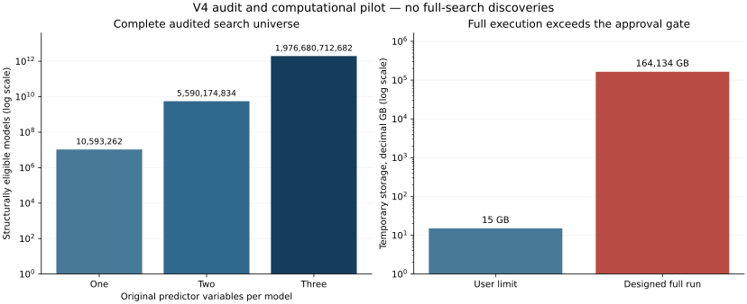

# Cross-domain discovery V4: audit and gated pilot

**Status: full execution stopped at the user's four-hour / 15 GB resource gate.** The complete structural audit and representative computational pilot are finished. No exhaustive result ranking, top-20 scientific findings, final evaluation fits, confidence intervals or multiple-testing discoveries have been produced. No scope reduction has been substituted for the requested exhaustive search.

The audit contains **10,097 target tasks**, **1,982,281,480,778 target/model combinations** and **7,929,125,923,112 planned fold fits**. A target task is a population × track × genre scope × target. Targets recur across tasks; this is not a count of distinct scientific constructs. Candidate counts are structural, before numerical estimability checks.

The pilot fitted **7,599 unique validation models** (2,533 sampled relationships across three folds), plus reference-check computation, for **20 representative tasks**. It made **8,679 numerical fit calls** and **zero final-evaluation fits**. All 7,599 checkpoint rows were reopened and verified. The 540 independent full-row SVD checks passed.

Of those validation fits, 1,052 were rank-deficient and remain diagnostics, not candidate scientific discoveries. The [bounded-pilot findings](findings.md) summarize the gate and the limitations revealed by the audit.

| Resource | Measurement or projection | User limit |
| --- | ---: | ---: |
| Pilot wall time, including audit projection | 4.03 minutes | Bounded pilot |
| Pilot process peak resident memory | 2.86 GiB | Measured, not extrapolated |
| V4 local artifacts at pilot completion | 0.438 GB | Local only |
| Full run, optimistic sampled-rate projection | 4,611.4 days | 4 hours |
| Full run, conservative projection | 37,930.8 days | 4 hours |
| Core full-result metric payload | 142.724 TB | 15 GB temporary storage |
| Designed full temporary storage | 164.134 TB | 15 GB |

These time figures extrapolate the existing single-thread OLS engine, not a measured full run or a guaranteed lower bound for other algorithms/hardware. The core storage design uses two float64 losses and one uint16 rank/status per candidate per fold; other metrics derive from fixed fold constants. Compression or a different storage design would require a revised, validated plan. Storage independently fails the gate even if compute is made much faster. The script cannot launch a full campaign.

| Pooled population | Track | Eligible target variables | Union of eligible predictors | Model combinations |
| --- | --- | ---: | ---: | ---: |
| song | raw | 420 | 1,311 | 97,367,323,018 |
| song | adjusted | 420 | 1,309 | 96,388,868,238 |
| monthly | raw | 442 | 1,281 | 100,435,836,143 |
| monthly | adjusted | 442 | 1,279 | 95,474,050,699 |
| genre_month | raw | 430 | 1,311 | 99,187,593,747 |
| genre_month | adjusted | 430 | 1,309 | 98,032,070,487 |

The genre-month search additionally audits all 16 observed primary-genre scopes. Some scopes have no chronologically supported tasks; they remain visible in [audit.json](audit.json). Counts above do not include those additional genre-specific tasks. All scopes and the six overlapping category views appear in [search_space.csv](search_space.csv); do not sum overlapping category views. Exact per-target metadata are compressed in [search_space_by_target.csv.xz](search_space_by_target.csv.xz).

## Evidence and interpretation

- [Methodology](methodology.md) defines identity, weighting, chronology, adjusted tracks, aliases, eligibility, and the inferential limitations.
- [Variable inventory](variable_inventory.csv) lists domains, sources, dependencies, availability, lag, transformation and support for every candidate; [target coverage](target_coverage.csv) records exclusion reasons.
- [External crosswalk](series_crosswalk.csv), [source exclusions](source_exclusions.csv), and [music exclusions](music_source_exclusions.csv) document exact aliases and unsupported fields. The external view has 189 canonical series after 59 verified financial/platform alias decisions; these are not 189 independent constructs.
- [Native-frequency support](native_frequency_support.csv.xz) reports row, month and target reference-period counts per fold. Reference periods are not effective independent sample sizes.
- [Benchmark](benchmark.json), [timing strata](benchmark_strata.csv), [direct OLS checks](ols_reference_checks.csv), [runtime versions](runtime_environment.json), and [protocol](analysis_protocol.json) are machine-readable evidence.
- [Validation](validation.json), [engineering checks](engineering_validation.json), and [publication manifest](publication_manifest.json) support read-only verification. Restricted measurements, model metrics, embeddings and checkpoints remain in ignored local storage.



## Reproduction

Run from the repository root using the existing project Python dependencies. Source acquisition and classification are unnecessary. Public verification needs only tracked files:

```bash
python3 src/cross_domain_v4_report.py verify
python3 -m unittest discover -s tests -p 'test_cross_domain_v4.py' -v
```

Rebuilding the bounded pilot requires the retained local source releases and private embedding evidence listed in [input_manifest.json](input_manifest.json). No lyrics are emitted. Preserve the existing protocol and checkpoints before changing analysis code or inputs; mismatches fail rather than silently reusing old results.

```bash
python3 src/cross_domain_v4_common.py preserve
python3 src/cross_domain_v4_data.py
python3 src/cross_domain_v4_audit.py
python3 src/cross_domain_v4_pilot.py
python3 src/cross_domain_v4_report.py build
python3 src/cross_domain_v4_report.py verify --private
python3 src/cross_domain_v4_common.py verify
```

The pilot command is bounded and rechecks previously saved model records on rerun. It does not execute the exhaustive campaign. The report command compacts the full audit CSV while preserving its per-target contents in XZ. Existing [project handoff](../../docs/PROJECT_STATE_HANDOFF.md), data releases and prior analysis artifacts retain their canonical paths and bytes.

The next decision is an explicit revision of scope or compute/storage budget, as required by the user's V4 resource gate. A larger budget alone does not establish that this machine can run the search. Any reduced campaign must be separately labelled and must not be represented as the original exhaustive V4 request.
