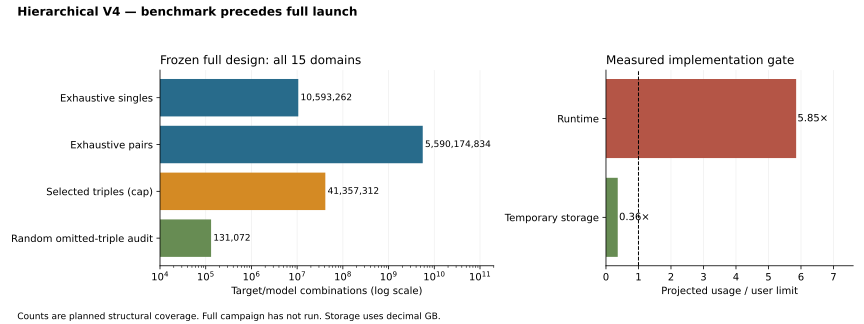

# Hierarchical cross-domain discovery V4

**Status: bounded pilot complete; full campaign not launched because the measured resource gate fails.** The revised design preserves the four-hour runtime and 15 GB temporary-storage limits. All original populations, raw/adjusted tracks, supported genre scopes, six calendar lags and 15 domains remain in scope. No economic or lyrical variable receives a subjective priority.

The complete design exhaustively attempts **10,593,262 one-predictor** and **5,590,174,834 two-predictor** relationships across **10,097 target tasks** in two screening periods. A fixed, domain-balanced rule retains at most **4,096 triples per target**, or **41,357,312 selected triples**, with **131,072 independently sampled rejected triples** for the screening audit. This is a bounded additive three-predictor search, with no interaction terms or claim of exhaustive triple coverage.

| Resource | Revised plan / measured pilot | Limit |
| --- | ---: | ---: |
| Pilot wall time charged to campaign | 7.47 minutes | 30-minute pilot cap |
| Pilot peak process memory | 4.07 GiB | Measured |
| Full computation projection before allowance | 15.35 hours | — |
| Conservative total including pilot | 23.40 hours | 4 hours |
| Full temporary-storage projection | 5.43 GB | 15 GB |
| Pilot checkpoint | 15.0 MB | Local only |

The gate uses actual measurements on this machine, shared-cohort preparation, measured target batches, maximum matching population/track rates, upward size scaling, a 1.5× compute allowance and 900 seconds for orchestration/reporting. It assumes no unmeasured parallel speedup. Resource projections are estimates for this implementation, not mathematical lower bounds for every possible implementation. The full command enforces the gate and pins its projection code. Restarted runs retain their cumulative runtime budget.

The pilot fully enumerated **44,375,488 lower-order relationships** (**88,750,976 screening-fold attempts**) for **74 deterministically selected target tasks**. It evaluated **303,104 selected triples** and **16,384 rejected audit triples** on two later periods. **1,072 independent full-row weighted SVD checks** agree with the fast engine; maximum baseline-scaled MSE discrepancy is 7.03e-12. These pilot counts must not be represented as a completed all-target campaign.

The random audit found **186 qualifying rejected triples**, sampled from **16,234,316,863 omitted eligible triples** in the pilot's 3,984 nonempty strata. The selected set contains **8,113 qualifying triples**. Within this pilot task population, the estimated fraction of qualifying triples missed by screening is **99.996%**, with a conservative simultaneous 95% interval of **15.020%–100.000%**. Many strata have only four draws, which limits precision. This is a design-based estimate conditional on a fixed predictive-stability criterion, not a causal false-negative rate. It does not estimate screening performance for the other target tasks. Audit outcomes never feed back into selection. The audit therefore does not support treating the screened triples as a near-exhaustive substitute. Many qualifying model combinations can describe the same underlying relationship, so this fraction is not a count of distinct missed scientific effects.

Read the [methodology](methodology.md), [benchmark gate](benchmark_gate.json), [execution ledger](pilot_execution.json), [target ledger](pilot_target_ledger.csv), [domain coverage](pilot_domain_coverage.csv), [random-audit estimates](pilot_screening_audit.json), [stratum estimates](pilot_audit_strata.csv), and [validation](validation.json), [engineering checks](engineering_validation.json), [audit replay](audit_replay_validation.json), and [launch-gate check](launch_gate_validation.json). The [parent V4 release](../cross_domain_discovery_v4/README.md) retains the complete input inventory, source reconciliation, exclusions and earlier exhaustive-search audit unchanged.



## Reproduction

Public verification checks tracked artifacts and code only:

```bash
python3 src/hierarchical_v4_report.py verify
python3 -m unittest discover -s tests -p 'test_hierarchical_v4.py' -v
```

With the retained private parent views and dictionaries, reproduce/verify the bounded pilot:

```bash
python3 src/hierarchical_v4_run.py audit
python3 src/hierarchical_v4_run.py pilot
python3 src/hierarchical_v4_report.py build
python3 src/hierarchical_v4_report.py verify --private
```

Completed checkpoints are reused. A code, runtime or input mismatch fails explicitly; preserve and version the prior run before revising it. The `full` action is available only after a matching benchmark passes the unchanged runtime/storage gate. A failed gate does not authorize dropping domains, sampling one/two-predictor combinations, or raising either limit. Private predictors, embeddings, model metrics and checkpoints remain under ignored local storage. No acquisition or classification is performed.
