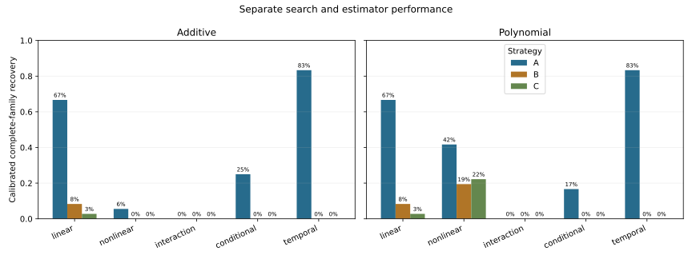

# V4 search-strategy benchmark

**Status: COMPLETE. Recommendation: E: None. No full discovery campaign was launched.**

This release implements three strategies over the unchanged V4 eligibility catalog: A, exhaustive vectorized pairwise screening plus bounded combinations and random exploration; B, stratified random search; and C, adaptive exploration/exploitation with a fixed random quota. All use the same early chronological validation, later assessment, training-only preprocessing, additive and polynomial estimators, native-period support and missing-data rules. All 15 eligible predictor domains remain in scope.

| Strategy | Model candidates attempted¹ | Pairwise relationships² | Charged comparison minutes | Sampled policy peak RSS (GiB)³ | Domains |
| --- | ---: | ---: | ---: | ---: | ---: |
| A | 1,165,234 | 647,727 | 46.63 | 4.42 | 15 |
| B | 1,052,216 | 0 | 39.44 | 4.42 | 15 |
| C | 1,037,896 | 0 | 39.46 | 4.50 | 15 |

¹ Each original-variable combination is attempted with both estimators; independent search-seed replicates are counted separately. Exact duplicates within a search are prohibited. ² A's exhaustive target/predictor diagnostic pass is a separate operation, not equivalent to a multivariable fit. ³ Includes common prepared data, sampled every 10 ms; the OS high-water mark for the whole process is reported separately.

The benchmark completed 197 cases and 1773 seeded searches. The latest execution segment took 69.82 minutes; the [cumulative ledger](resource_segments.csv), including development, the preserved calibration restart and storage-paused execution, charged 135.43 minutes. Peak RSS in the latest process was 4.68 GiB; per-strategy tables retain the high-water marks from earlier segments too. Local benchmark artifacts occupied 2.022 GB at completion. These measurements are not a full-universe production run.

The benchmark stopped safely 2 time(s) when filesystem free space fell below its 2 GiB reserve. The [stop records](preserved_storage_stops.json) are preserved. After disk space was made available, the unchanged frozen protocol resumed its verified candidate prefixes. No scientific inputs, prior results, resource limits or search settings were changed to bypass those stops.

## Recovery on final synthetic worlds

The following uses the union of both estimator paths and complete **family-level** support, crediting declared redundant proxies. It includes only mechanisms designed to remain stable. Exact-variable recovery, oracle transfer diagnostics, model-specific results, raw/adjusted tracks, and seed/world uncertainty are reported separately. Pure interactions and conditional mechanisms must not be inferred from the linear row.

| Stable signal type | A | B | C |
| --- | ---: | ---: | ---: |
| linear | 66.7% | 8.3% | 2.8% |
| nonlinear | 47.2% | 19.4% | 22.2% |
| interaction | 0.0% | 0.0% | 0.0% |
| conditional | 25.0% | 0.0% | 0.0% |
| temporal | 83.3% | 0.0% | 0.0% |

This is calibrated later-period recovery, not simply inclusion in a sampled pool. The [recall table](discovery_recall.csv) separates search omission, selected-model failure and oracle transfer failure. Oscillatory signals intentionally exceed the polynomial path's representational scope. The [regime-reversal controls](regime_reversal_results.csv) measure rejection of unstable relationships. Observational [reference recovery](known_reference_results.csv) is not causal ground truth.

No measured policy jointly meets the prespecified per-family recall, null-behavior and full-universe resource criteria. A hybrid has not been benchmarked and is not presented as a proven solution.

Start with [findings](findings.md), [frozen design](benchmark_design.md), [methodology](methodology.md), [comparison](strategy_comparison.csv), [signal results](synthetic_signal_results.csv), [null behavior](null_calibration.csv), [coverage](domain_coverage.csv), [seed stability](seed_stability.csv), [runtime measurements](runtime_benchmarks.csv), [production projections](production_projection.csv), and [recommendation](recommendation.json).

The [experiment audit](validation.json) records checkpoint eligibility, selection-order, metric and numerical-replay checks. The [engineering validation](engineering_validation.json) records the test suite, original-file preservation and earlier-release integrity checks.

The [estimator audit](estimator_limitations.json) identifies an important coverage limit: no adjusted-monthly case produced selected models under the frozen strict rank gate. Checked nuisance matrices have rank 18 of 19. These failed cases remain in overall recovery totals, but cannot establish search-policy performance. The source control basis and rank policy need separate evaluation before production; final-scoring results have not been retuned.



## Reproduction

Public verification needs the tracked publication and source files:

```bash
python3 src/strategy_v4_report.py verify
python3 -m unittest discover -s tests -p 'test_strategy_v4.py' -v
```

When loading these CSVs with pandas, use `keep_default_na=False, na_values=['']` to preserve the literal signal-family label `null` while treating empty cells as missing.

Replaying experiments requires the retained private V4 views and registry inputs listed in [frozen_protocol.json](frozen_protocol.json). Use the recorded Python/package versions; no new acquisition or classification is needed. The benchmark runner resumes verified checkpoints and retains cumulative budget usage. It exposes **no full-campaign action**.

```bash
python3 src/strategy_v4_run.py audit
python3 src/strategy_v4_run.py benchmark
python3 src/strategy_v4_report.py build
python3 src/strategy_v4_report.py verify --private --replay
python3 -m unittest discover -s tests -v
```

Large per-candidate records, synthetic observations, protected input values and checkpoints stay local. Synthetic observations are regenerated in memory; truth and results are retained in the private checkpoint. Original datasets and prior regression releases remain untouched. Core-code/configuration/input/runtime mismatches fail rather than reusing an incompatible checkpoint. Preserve and version an old attempt before changing it. A future production campaign requires explicit approval.
