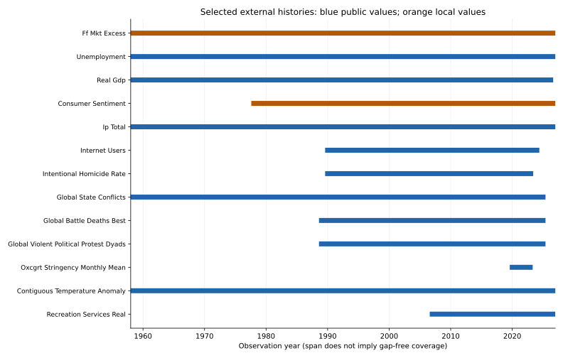

# External historical platform v1

The separate historical layer contains **101 source series** and **36 explicitly derived series**, totaling **184,845 native observations**. Financial, macroeconomic, political, social and cultural tables share one provenance schema. Original frequency is retained; dates span earlier warm-up history through available 2026 observations, with provider-specific end dates and gaps.

[Source inventory](source_inventory.csv) · [Source dictionary](series_dictionary.csv) · [Derived dictionary](derived_series_dictionary.csv) · [Coverage](coverage_report.csv) · [Alignment](temporal_alignment.md) · [Join validation](join_validation.md) · [Research opportunities](research_opportunities.md) · [Public downloads](../../data/public/external_historical_v1/README.md).

The public release contains **56,469 permitted observations**. French market returns, Michigan survey values and NBER chronology values stay local pending redistribution permission. Official US statistical series, World Bank indicator data, UCDP and Oxford policy aggregates retain their respective attribution and source terms.

There are 818 overall music months, all with at least one external observation. This does not mean every series covers every month. Natural quarterly and annual views preserve lower-frequency information; the [coverage table](coverage_report.csv) lists each series. Daily series are not silently treated as monthly observations.

This campaign builds data and joins only. The independently developed [financial research catalog](financial_research/README.md) and financial acquisition subdirectory are separate work; this release does not absorb their source snapshots or code.
