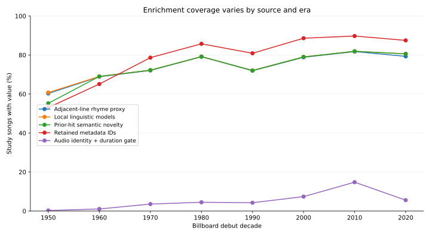

# Music enrichment v2

This version retains all **28,041 exact Billboard title/artist identities**, all 70 original song fields, the frozen 57 engineered constructs, and 42 classifier scores. It adds 181 documented columns, including provenance and diagnostics. The [construct inventory](construct_inventory.csv) groups these into **91 new constructs** including three chart-period measures and one private embedding representation: **148 engineered groups in total**, separate from the original classifiers. These groups are not assumed statistically independent.

[Downloadable version](../../data/public/music_enrichment_v2/README.md) · [Feature audit](feature_inventory.csv) · [Dictionary](feature_dictionary.csv) · [Coverage](coverage_report.csv) · [Provenance and reproduction](provenance.md) · [Findings](findings.md).

The audit reconciles 188 rows, including 182 credible candidates, against the existing implementation. No frozen feature was recalculated. Local text inference finished for 20,981 approved texts. Audio characteristics passed the exact recording/credit/duration gate for 1,405 songs. Newly retrieved MusicBrainz data passed the exact ID/credit gate for 1,048 songs. Original release editions remain unverified.

The monthly views contain 818 months and 7,173 observed genre-month units. Means use available source rows, retain the three repeated source song/month pairs, and report distinct-song counts separately. Each feature has its own nonmissing denominator. These are retrospective measurements, including modern-model text diagnostics; chart-history prefix restrictions do not turn modern measurements into historical forecasts.

The separate [historical layer](../external_historical/README.md) supplies contextual joins. No new cross-domain regressions, hypothesis tests, COVID breakpoint selection or causal claims were run.
