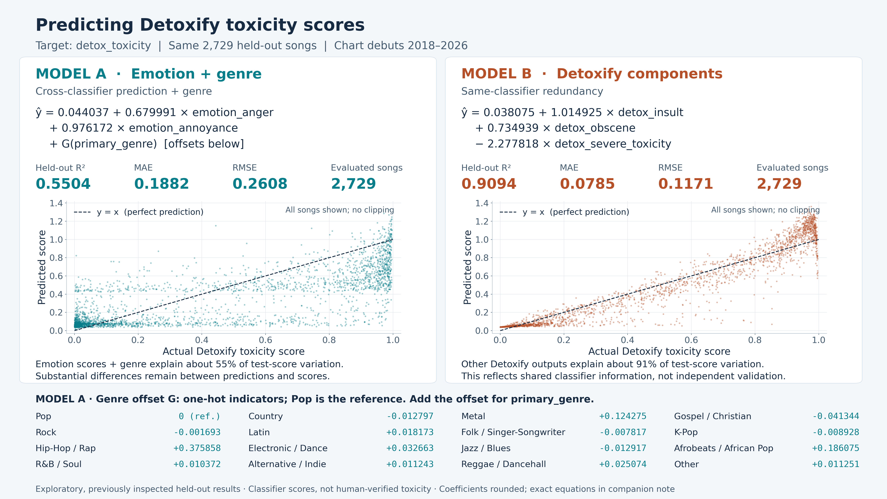

# Two saved toxicity regressions



The 4800 × 2700 PNG compares predictions of the **Detoxify toxicity classifier score**, not human-verified toxicity. Each scatterplot contains all 2,729 evaluated songs, with identical axes and a y=x reference. OLS predictions are not clipped to [0, 1].

These are **exploratory, previously inspected held-out results**. Model A is the previous post-hoc cross-domain selection; Model B is the original unrestricted validation winner. Their existing selections, fitted parameters, predictions and evaluations were reused unchanged. No model was fitted or reselected for this figure.

| Model | Original predictors | Held-out R² | MAE | RMSE | Evaluated songs |
|---|---|---:|---:|---:|---:|
| A — Emotion + genre | `emotion_anger`, `emotion_annoyance`, `primary_genre` | 0.5504118590177723 | 0.1881693908024666 | 0.2608155188207505 | 2,729 |
| B — Detoxify components | `detox_insult`, `detox_obscene`, `detox_severe_toxicity` | 0.9094045731925376 | 0.07851930591212232 | 0.1170790373664569 | 2,729 |

## Exact equations in original score units

Let `y_hat` be predicted `detox_toxicity`. The following coefficients retain 17 significant digits. The figure rounds to six decimal places for readability; plots and metrics always use the original saved predictions.

**Model A**

```text
y_hat = 0.044036548834337462
        + 0.679990667538938 * emotion_anger
        + 0.97617156505362312 * emotion_annoyance
        + G(primary_genre)
```

**Model B**

```text
y_hat = 0.038075174276310852
        + 1.0149254945677151 * detox_insult
        + 0.73493853832929734 * detox_obscene
        - 2.2778180858929331 * detox_severe_toxicity
```

Model A uses the original fixed 16-category taxonomy: **Pop is the reference** and its offset is zero. Fifteen one-hot indicators represent the other genres. Equivalently, `G = sum(coefficient[g] * I(primary_genre == g))` over non-Pop genres. It is one original predictor with 15 encoded columns, not a numeric genre rank.

| primary_genre | Offset relative to Pop |
|---|---:|
| Pop | 0 |
| Rock | -0.0016934189171744093 |
| Hip-Hop / Rap | 0.37585831812133885 |
| R&B / Soul | 0.010371898467164534 |
| Country | -0.012796903582813303 |
| Latin | 0.018173281125567965 |
| Electronic / Dance | 0.03266290167578928 |
| Alternative / Indie | 0.011243181770263311 |
| Metal | 0.12427466077697673 |
| Folk / Singer-Songwriter | -0.0078172279001511615 |
| Jazz / Blues | -0.012916972558829161 |
| Reggae / Dancehall | 0.025074371627236657 |
| Gospel / Christian | -0.041343988740245315 |
| K-Pop | -0.0089284734187280255 |
| Afrobeats / African Pop | 0.18607522696672282 |
| Other | 0.011251486271213371 |

The saved models center the target and standardize each retained input column. The equations above undo this exactly algebraically: `b_j = beta_j / std_j`; `intercept = target_center + beta_0 - sum(b_j * mean_j)`. Original stored coefficients, centers and encoders are also preserved in `verification.json`.

No evaluated predictor values are missing. The original encoder would replace a missing numerical score with its training median (recorded in `verification.json`). Missingness indicators were constant zero during training and dropped. The genre-missing indicator was also dropped; missing genre therefore contributes zero offset. All 15 non-reference genre indicators were retained.

## Interpretation and evaluation

**A: cross-classifier prediction plus genre.** Emotion anger/annoyance scores and genre account for about 55% of held-out Detoxify-score variance. Substantial errors remain. Genre offsets are conditional associations relative to Pop, holding the emotion scores fixed; they are not causal effects or judgments about genres.

**B: same-classifier redundancy.** Three other Detoxify outputs account for about 91% of held-out Detoxify-score variance. The stronger fit reflects overlapping outputs from the same classifier, not independent validation of toxicity. The negative severe-toxicity coefficient is a conditional multivariable coefficient; it does not imply that severe language reduces toxicity.

Both saved models used 18,106 observed-target songs whose first and last chart dates precede 2018-01-01 for the final fit. The same 2,729 observed-target test songs debuted from 2018-01-06 to 2026-09-19. Songs crossing the training boundary were purged under the original protocol. Each evaluated song has weight 1. Chart debuts are not release dates. This is retrospective cohort transfer, not an as-of forecast or a new COVID analysis.

Verification checks source/model/prediction/split hashes, exact song IDs and row membership, original saved preprocessing, all predictions, and R²/MAE/RMSE against both saved metric files and published leaderboards (absolute tolerance 1e-12). No artifacts were unavailable; no deterministic refit or recovery was needed.

| Model | Maximum prediction replay error | Maximum original-unit equation error |
|---|---:|---:|
| A | 0 | 2.22e-16 |
| B | 0 | 4.44e-16 |

## Saved sources and reproduction

- Model A: `data/experiments/regression_search/meaningful_v1/models/songs__detox_toxicity/15894/model.json`; `predictions.csv.gz` and `metrics.json` in the same directory.
- Published evaluation A: `analysis/regression_search/meaningful/cross_domain_leaderboard.csv`.
- Model B: `data/experiments/regression_search/campaign/songs__detox_toxicity/selected_model.json`; `test_predictions.csv.gz` and `test_metrics.json` in the same directory.
- Published evaluation B: `analysis/regression_search/campaign/target_leaderboard.csv`.

The local model/prediction files remain ignored by Git; this figure requires those retained artifacts to reproduce. Public input is `data/public/songs.csv`. SHA-256 provenance, full precision equations, runtime versions and image hash are in [verification.json](verification.json).

```bash
python3 analysis/regression_search/presentation/render.py --verify-only
python3 analysis/regression_search/presentation/render.py
python3 -m unittest discover -s tests -p test_toxicity_presentation.py -v
```

Rendering writes this presentation directory and registers its PNG hash in `analysis/figure_manifest.json`. That catalog is also pinned by the historical publication, so its `preservation_manifest.json` records the original/current catalog hashes and the single added figure; its `artifact_manifest.json` pins the revised preservation metadata. The renderer verifies that every pre-existing catalog entry and hash is unchanged against the recorded Git baseline. Existing data, model artifacts, numerical analysis results and figures are unchanged.
