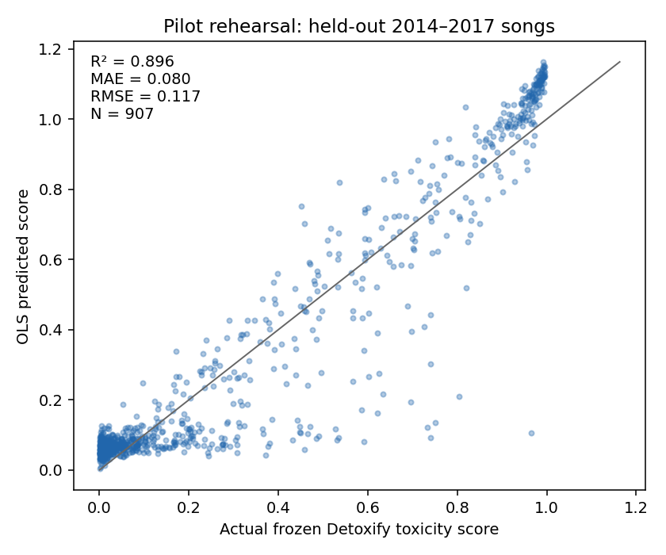

# Exhaustive regression search: three-predictor OLS

**Implementation and bounded pilot complete. Full campaign NOT launched.**
Revised 2026-10-20 under the explicit three-predictor, OLS-only instruction.
The [previous four-predictor feasibility report](regression_search_four_predictor_feasibility.md)
is retained as a historical snapshot; its Ridge grid, four-variable fits and runtime
estimates do not describe this campaign.

## Search space and current data

The current public files were read again and hashed: 28,041 song rows, 81,797
monthly rows and 355,487 weekly rows. Their existing IDs, 16 genres, continuous
classifier scores and all source observations are preserved. The teammate
preprocessing tables remain untouched; their removed IDs and thresholded scores
make them unsuitable substitutes for these inputs. Eight audited public/preprocessing
file hashes remain unchanged.

| Numerical OLS campaign | Count |
|---|---:|
| Targets | 59 |
| One original predictor | 3,466 |
| Two original predictors | 100,118 |
| Three original predictors | 1,895,317 |
| Total combinations | **1,998,901** |
| Previous four-predictor total, recalculated from current eligibility | 28,442,928 |
| Removed four-predictor combinations | 26,444,027 |
| Reduction | **92.97%** |
| Three-period OLS fits before final selected refits | 5,996,703 |

There are **14 separate categorical/ordinal tasks**: seven rank outcomes, one
ordinal annotation-confidence outcome, four multiclass outcomes, one binary
outcome and one multilabel outcome. Their allowed sets are still inventoried.
They are explicitly deferred pending a native-family model specification; no
OLS category coding or fabricated classification leaderboard is produced. The
[separate registry](../analysis/regression_search/specification/categorical_ordinal_tasks.csv)
records appropriate metrics and status.

The numerical panel consists of 42 lyric scores, three duration summaries,
three MusicBrainz counts, four observed chart-history counts, four history-date
coordinates, linked release year, and monthly/weekly reported weeks on chart.
Exact per-target predictors, reasons for every exclusion, and forbidden subsets
are in [predictor_eligibility.json](../analysis/regression_search/specification/predictor_eligibility.json).
The following table includes every eligible task; `p` is the eligible conceptual
predictor count. Categorical/ordinal counts are inventory only.

| Task | Family | p | k=1 | k=2 | k=3 | Total |
| --- | --- | --- | --- | --- | --- | --- |
| `songs:ll_sexual_content` | regression | 59 | 59 | 1,711 | 32,508 | 34,278 |
| `songs:ll_violence` | regression | 59 | 59 | 1,711 | 32,508 | 34,278 |
| `songs:ll_explicit_language` | regression | 59 | 59 | 1,711 | 32,508 | 34,278 |
| `songs:ll_substance_use` | regression | 59 | 59 | 1,711 | 32,508 | 34,278 |
| `songs:detox_toxicity` | regression | 59 | 59 | 1,711 | 32,508 | 34,278 |
| `songs:detox_severe_toxicity` | regression | 59 | 59 | 1,711 | 32,508 | 34,278 |
| `songs:detox_obscene` | regression | 59 | 59 | 1,711 | 32,508 | 34,278 |
| `songs:detox_threat` | regression | 59 | 59 | 1,711 | 32,508 | 34,278 |
| `songs:detox_insult` | regression | 59 | 59 | 1,711 | 32,508 | 34,278 |
| `songs:detox_identity_attack` | regression | 59 | 59 | 1,711 | 32,508 | 34,278 |
| `songs:detox_sexual_explicit` | regression | 59 | 59 | 1,711 | 32,508 | 34,278 |
| `songs:emotion_admiration` | regression | 59 | 59 | 1,711 | 32,508 | 34,278 |
| `songs:emotion_amusement` | regression | 59 | 59 | 1,711 | 32,508 | 34,278 |
| `songs:emotion_anger` | regression | 59 | 59 | 1,711 | 32,508 | 34,278 |
| `songs:emotion_annoyance` | regression | 59 | 59 | 1,711 | 32,508 | 34,278 |
| `songs:emotion_approval` | regression | 59 | 59 | 1,711 | 32,508 | 34,278 |
| `songs:emotion_caring` | regression | 59 | 59 | 1,711 | 32,508 | 34,278 |
| `songs:emotion_confusion` | regression | 59 | 59 | 1,711 | 32,508 | 34,278 |
| `songs:emotion_curiosity` | regression | 59 | 59 | 1,711 | 32,508 | 34,278 |
| `songs:emotion_desire` | regression | 59 | 59 | 1,711 | 32,508 | 34,278 |
| `songs:emotion_disappointment` | regression | 59 | 59 | 1,711 | 32,508 | 34,278 |
| `songs:emotion_disapproval` | regression | 59 | 59 | 1,711 | 32,508 | 34,278 |
| `songs:emotion_disgust` | regression | 59 | 59 | 1,711 | 32,508 | 34,278 |
| `songs:emotion_embarrassment` | regression | 59 | 59 | 1,711 | 32,508 | 34,278 |
| `songs:emotion_excitement` | regression | 59 | 59 | 1,711 | 32,508 | 34,278 |
| `songs:emotion_fear` | regression | 59 | 59 | 1,711 | 32,508 | 34,278 |
| `songs:emotion_gratitude` | regression | 59 | 59 | 1,711 | 32,508 | 34,278 |
| `songs:emotion_grief` | regression | 59 | 59 | 1,711 | 32,508 | 34,278 |
| `songs:emotion_joy` | regression | 59 | 59 | 1,711 | 32,508 | 34,278 |
| `songs:emotion_love` | regression | 59 | 59 | 1,711 | 32,508 | 34,278 |
| `songs:emotion_nervousness` | regression | 59 | 59 | 1,711 | 32,508 | 34,278 |
| `songs:emotion_optimism` | regression | 59 | 59 | 1,711 | 32,508 | 34,278 |
| `songs:emotion_pride` | regression | 59 | 59 | 1,711 | 32,508 | 34,278 |
| `songs:emotion_realization` | regression | 59 | 59 | 1,711 | 32,508 | 34,278 |
| `songs:emotion_relief` | regression | 59 | 59 | 1,711 | 32,508 | 34,278 |
| `songs:emotion_remorse` | regression | 59 | 59 | 1,711 | 32,508 | 34,278 |
| `songs:emotion_sadness` | regression | 59 | 59 | 1,711 | 32,508 | 34,278 |
| `songs:emotion_surprise` | regression | 59 | 59 | 1,711 | 32,508 | 34,278 |
| `songs:emotion_neutral` | regression | 59 | 59 | 1,711 | 32,508 | 34,278 |
| `songs:sentiment_negative` | regression | 59 | 59 | 1,710 | 32,452 | 34,221 |
| `songs:sentiment_neutral` | regression | 59 | 59 | 1,710 | 32,452 | 34,221 |
| `songs:sentiment_positive` | regression | 59 | 59 | 1,710 | 32,452 | 34,221 |
| `songs:mb_duration_median_seconds` | regression | 59 | 59 | 1,711 | 32,508 | 34,278 |
| `songs:mb_duration_min_seconds` | regression | 59 | 59 | 1,711 | 32,508 | 34,278 |
| `songs:mb_duration_max_seconds` | regression | 59 | 59 | 1,711 | 32,508 | 34,278 |
| `songs:mb_recording_count` | regression | 59 | 59 | 1,711 | 32,508 | 34,278 |
| `songs:mb_release_count` | regression | 59 | 59 | 1,711 | 32,508 | 34,278 |
| `songs:mb_distinct_duration_count` | regression | 59 | 59 | 1,711 | 32,508 | 34,278 |
| `songs:weekly_observation_count` | regression | 59 | 59 | 1,711 | 32,508 | 34,278 |
| `songs:chart_weeks` | regression | 59 | 59 | 1,711 | 32,508 | 34,278 |
| `songs:total_chart_points` | regression | 59 | 59 | 1,711 | 32,508 | 34,278 |
| `songs:snapshot_months_selected` | regression | 59 | 59 | 1,711 | 32,508 | 34,278 |
| `songs:first_chart_date` | regression | 50 | 50 | 1,225 | 19,599 | 20,874 |
| `songs:last_chart_date` | regression | 59 | 59 | 1,711 | 32,508 | 34,278 |
| `songs:first_snapshot_month` | regression | 59 | 59 | 1,711 | 32,508 | 34,278 |
| `songs:last_snapshot_month` | regression | 59 | 59 | 1,711 | 32,508 | 34,278 |
| `songs:mb_release_year` | regression | 59 | 59 | 1,711 | 32,508 | 34,278 |
| `songs:best_chart_rank` | ordinal_rank | 59 | 59 | 1,711 | 32,508 | 34,278 |
| `songs:primary_genre` | multiclass | 58 | 58 | 1,653 | 30,855 | 32,566 |
| `songs:secondary_genres` | multilabel | 58 | 58 | 1,653 | 30,855 | 32,566 |
| `songs:musicbrainz_match_status` | multiclass | 53 | 53 | 1,378 | 23,425 | 24,856 |
| `songs:mb_release_date_precision` | multiclass | 53 | 53 | 1,378 | 23,425 | 24,856 |
| `songs:lyrics_status` | multiclass | 18 | 18 | 153 | 816 | 987 |
| `songs:lyrics_available` | binary | 18 | 18 | 153 | 816 | 987 |
| `songs:genre_confidence` | ordinal_diagnostic | 60 | 60 | 1,770 | 34,219 | 36,049 |
| `monthly:monthly_rank` | ordinal_rank | 55 | 55 | 1,485 | 26,234 | 27,774 |
| `monthly:reported_last_week_rank` | ordinal_rank | 52 | 52 | 1,326 | 22,099 | 23,477 |
| `monthly:reported_peak_position` | ordinal_rank | 56 | 56 | 1,540 | 27,719 | 29,315 |
| `monthly:reported_weeks_on_chart` | regression | 56 | 56 | 1,540 | 27,719 | 29,315 |
| `weekly:weekly_rank` | ordinal_rank | 55 | 55 | 1,485 | 26,234 | 27,774 |
| `weekly:reported_last_week_rank` | ordinal_rank | 52 | 52 | 1,326 | 22,099 | 23,477 |
| `weekly:reported_peak_position` | ordinal_rank | 56 | 56 | 1,540 | 27,719 | 29,315 |
| `weekly:reported_weeks_on_chart` | regression | 56 | 56 | 1,540 | 27,719 | 29,315 |

## Predictors, encoding and justified restrictions

The song-level candidate pool contains the 58 numerical/ordinal measurements
(including `best_chart_rank`) plus `primary_genre` and `secondary_genres`.
The chart-resolution pools add the current rank, chart date, previous-week rank,
reported peak and reported weeks. Every permitted one-, two- and three-variable
subset is evaluated; no correlation screening, stepwise search, greedy selection
or manual choice of interesting predictors is used. The deterministic pilot is
a bounded hash sample, not the exhaustive candidate selection policy.

Exclusions remain the audited ones:

- The target itself; identifiers, arbitrary source coordinates, acquisition/status
  flags as predictors, and duplicate date representations.
- Full-history/end-of-month attributes for earlier chart-state targets. Previous-week
  rank tasks additionally exclude later current-chart measurements. Current rank
  tasks cannot use a peak field that already incorporates that target rank.
- For a sentiment target, the other two sentiment components cannot appear
  together; for other targets all three sentiment components cannot appear together.
  GoEmotions outputs are independent sigmoid scores and have no analogous sum rule.
- Primary and secondary genres cannot predict each other because the label
  construction excludes the primary label from the secondary set.
- Lyrics acquisition diagnostics cannot use the scores or their missing indicators;
  MusicBrainz match/precision diagnostics cannot use downstream accepted metadata.
- `first_chart_date` cannot use genres or accepted MusicBrainz metadata because
  those production/matching processes explicitly consumed that date.

Toxicity–insult relationships, correlated duration summaries and nearly identical
chart counts remain eligible. They need interpretation labels, not silent exclusion.
Other non-identity history/date relationships remain eligible in retrospective song
tasks. These are not certified historical forecasts: enrichment was obtained later,
and source/matching selection can carry temporal information.

Only additive OLS with an intercept is fitted. Song rows have unit weight;
chart rows have inverse within-partition song frequency, normalized to mean one.
This is song-balanced least squares, implemented as OLS on square-root-weighted rows.
There are no interactions, penalties, trees or neural networks.

Each original genre variable counts once even when encoded into many columns.
Primary genre uses the fixed public taxonomy with Pop reference; secondary genre
uses multi-hot labels, with `[]` an observed empty set. Missing indicators stay tied
to their original variable. Numeric medians and unweighted means/standard deviations
are learned only on each training fold. Constant encoded columns are removed,
including wholly absent predictors; the conceptual combination remains evaluated.
Unsupported category columns in held-out rows are counted. Maximum encoded width
is 36 coefficients (intercept, both genres and one numeric variable), not three.

Outcomes are never imputed. Every combination for a target uses the same observed-
target training and evaluation rows. Missingness may itself be predictive and
selective; coverage is always reported alongside performance.

## Validation, selection and the two result views

Use three expanding validation periods: 1990–1999, 2000–2009 and 2010–2017.
For each period, training songs must debut and finish their observed chart history
before the period starts. Validation songs must debut in that period and finish
before it ends. Entire boundary-crossing songs are purged. Every song ID is
confined to one partition within a fold; the same earlier song can legitimately
train a later expanding fold. Preprocessing is fitted inside each training fold.

Selection uses equal-period mean baseline-relative MSE skill:
`mean_f(1 - MSE_model_f / MSE_training_mean_baseline_f)`.
Exact ties prefer fewer original variables, then lexicographic predictor names.
R² uses each held-out period's weighted target variance. The prediction baselines
are the training weighted mean for squared error and training weighted median for
MAE. Zero denominators produce undefined metrics, never a successful score.

**View A — predictor hierarchy.** Each target's SQLite `hierarchy` view ranks every
combination, including poor ones. It contains conceptual count, validation R²,
MAE, RMSE, sample sizes, baseline comparisons and each period's metrics. Reported
aggregate R²/MAE are equal-period means; aggregate RMSE is the square root of
mean period MSE. The selection rank follows baseline skill, so it need not equal
the ordering by average R² when period variances differ. Filtering by `k` is
supported, and winners for each of one, two and three predictors are explicit.
The [complete sampled hierarchy](../analysis/regression_search/pilot/predictor_hierarchy.csv)
and [best by count](../analysis/regression_search/pilot/best_by_predictor_count.csv)
demonstrate the format.

**View B — target predictability leaderboard.** Finish all 59 validation searches,
verify their identities and freeze every winner before evaluating any campaign
test outcome. Refit each selected model and its preprocessing on all eligible
pre-2018 songs whose last chart date is before 2018. Evaluate once on songs
debuting from 2018 onward. Save test R², MAE, RMSE, baseline skill/performance,
row/song counts, validation-to-test differences, selected model and uncertainty.
Rank targets by test R², never by raw MAE across seconds, years, counts and scores.
Different target coverage and intrinsic measurement noise still limit comparisons.

Millions of validation comparisons can yield optimistic winners. Three periods
reduce dependence on one era but do not remove selection bias. The implementation
locks the universe, metrics and tie rule, saves every attempted set, reports the
selected model's rank/skill and the best set within each historical period, and
reserves the later test for the frozen selection. Final intervals use 500
song-cluster bootstrap samples of fixed predictions; supplementary two-year
debut-block intervals are available with at least three blocks. Few calendar
blocks limit those intervals. Neither bootstrap repeats selection/refitting, so
these are conditional performance intervals, not selection-procedure uncertainty,
simultaneous intervals over 59 targets, or selected-coefficient significance tests.
The complete target panel must be reported: choosing the top target from test
results creates another selection effect. No causal or “objectively random”
interpretation follows from high or low predictability.

The source data already supported public EDA. “Untouched test” means untouched
by this regression search/selection, not never previously described.

**Censoring audit.** Histories end at 2026-09-19. Among 2020s debut songs, 776 have
under two years of possible follow-up and 177 were last seen in the final 90 days.
Career targets therefore describe observed-through-snapshot history, not lifetime
success. The [cohort audit](../analysis/regression_search/specification/censoring_audit.json)
and final cohort metrics expose this limitation. Whole-song purging also selects
against long-lived/recurrent songs. A fixed-horizon or survival analysis would be
a different approved experiment.

## Implementation and measured feasibility

The engine reuses one encoded matrix per target/period, caches weighted
cross-products and a QR factorization of the augmented design/outcome, and fits
small selected systems in batches. Well-conditioned Gram systems use a batched
eigendecomposition. When the Gram condition exceeds 1e8, SVD uses the cached QR
factor, preserving the selected design's singular values without repeatedly
gathering and fitting all training rows. Its explicit rank cutoff uses the
original training row count. Rank-deficient sets are retained and logged.

Every candidate's predictions and exact absolute/squared errors are computed in
bounded row batches. This avoids cancellation for dates and nearly exact fits.
MAE cannot be recovered from cross-products, so prediction remains necessary.
There is no finalist-only approximation. Optional independent target processes
each use one BLAS thread; the estimate assumes one measured worker.

SQLite transactions commit metrics and progress together. Interrupted uncommitted
batches rerun; committed fits are skipped. Input hashes, source code hashes,
library versions, eligibility, sample identity and configuration must match to
resume. Exact source-row/song membership is saved for every split. Every candidate
has three metric rows, not a saved model object. Final selected models have JSON
encoding parameters and coefficients, predictions and artifact hashes.

The bounded pilot covered **1,179 unique combinations
across nine targets**, all three sizes and four encoding-width strata where valid.
It included lyric-score missingness, metadata missingness, near-identical chart
counts, both genres, monthly observations and weekly observations. The rehearsal
uses 1990–1999, 2000–2009 and 2010–2013 validation, with 2014–2017 as its held-out
test. A separate equally bounded timing pass uses the actual three campaign
validation periods. **No 2018-onward final-test row was evaluated.**

| Measured/estimated quantity | Result |
|---|---:|
| Validation fits in the full-population timing pass | 3,537 |
| Kernel validation fits/second (fit + exact metrics) | 7,218 |
| Sampled combinations/second including recorded per-target setup/checks | 30.3 |
| Estimated single-worker full search | **0.18 hours (11 minutes)** |
| Planning range, not a statistical interval | 0.09–0.53 hours |
| Additional final refits and bootstrap allowance | 5–15 minutes |
| Peak process RAM | 2.52 GiB |
| Estimated compact results | 1.05 GiB |
| Estimated retained results/splits | 1.20 GiB |
| Recommended free disk including journals/exports | 3.60 GiB |

The extrapolation enumerates exact k/genre strata for all 59 targets, scales
held-out metric work by actual validation-row counts, includes measured checkpoint
writes, scales catalog/ranking overhead by candidate count, and adds target setup
once. Pilot total throughput includes direct correctness fits and preparation that
are amortized in the full search; multiplying that rate by all combinations would
misrepresent the workload. Genre strata are deliberately oversampled in the pilot.
The estimate is machine-specific and uncertain: singularity mix, larger batches,
sorting, thermal conditions and disk contention can differ. The wide planning
range is a scenario bound, not a guarantee. No parallel speedup is assumed.
See [runtime strata](../analysis/regression_search/pilot/runtime_strata.csv) and
[benchmark evidence](../analysis/regression_search/pilot/benchmark.json).

## Example outputs and professor demonstration

The following is a **bounded rehearsal leaderboard**, not the exhaustive result
or the campaign's final test. All rows use the 2014–2017 rehearsal holdout.

| Target | Selected predictors | k | Holdout R² | MAE | RMSE | Rows |
| --- | --- | --- | --- | --- | --- | --- |
| `songs:chart_weeks` | emotion_relief, ll_explicit_language, weekly_observation_count | 3 | 1.0000 | 0.0045 | 0.0058 | 1,112 |
| `songs:detox_toxicity` | detox_obscene, secondary_genres, sentiment_negative | 3 | 0.8959 | 0.0797 | 0.1170 | 907 |
| `songs:sentiment_positive` | detox_obscene, secondary_genres, sentiment_negative | 3 | 0.6839 | 0.0247 | 0.0318 | 907 |
| `songs:mb_duration_median_seconds` | mb_duration_min_seconds, mb_recording_count | 2 | 0.6470 | 17.7411 | 23.1926 | 1,011 |
| `songs:mb_release_year` | first_snapshot_month, secondary_genres, sentiment_negative | 3 | 0.6410 | 0.5717 | 0.7670 | 1,005 |
| `weekly:reported_weeks_on_chart` | emotion_confusion, mb_release_year, reported_peak_position | 3 | 0.4216 | 4.0360 | 5.6140 | 18,089 |
| `songs:emotion_joy` | emotion_relief, ll_sexual_content, primary_genre | 3 | 0.3497 | 0.0281 | 0.0558 | 907 |
| `monthly:reported_weeks_on_chart` | emotion_confusion, mb_release_year, reported_peak_position | 3 | 0.3411 | 4.7026 | 6.2551 | 4,158 |
| `songs:ll_violence` | detox_toxicity, primary_genre | 2 | 0.0896 | 0.3159 | 0.3989 | 907 |

The [machine-readable leaderboard](../analysis/regression_search/pilot/target_leaderboard.csv)
also includes baseline comparisons, validation-to-test differences, coverage,
cohort metrics and bootstrap intervals. The [stability table](../analysis/regression_search/pilot/historical_stability.csv)
shows period-specific winners and ranks. Near-identity chart counts and same-model
score agreement require interpretation even when their R² is high.

Run `python3 src/regression_search.py demo` after the bounded pilot. It loads
the trained coefficients, reconstructs preprocessing from saved parameters and
verifies all persisted predictions before producing the CLI report and plot.

```text
Target: detox_toxicity
Predictors (3): detox_obscene, secondary_genres, sentiment_negative
Training rows: 17,094; held-out rehearsal rows: 907
R² 0.8959; MAE 0.0797; RMSE 0.1170
Training-mean baseline R² -0.3404; RMSE 0.4199; training-median baseline MAE 0.3140
95% song-bootstrap R² interval: [0.8717653962077128, 0.9174236122319874]
Interpretation: this measures agreement among frozen model outputs on later songs. It does not establish causation or accuracy against human toxicity labels. The winner comes from a bounded deterministic sample, not the exhaustive campaign. OLS predictions are unbounded and are not clipped.
The campaign's 2018-onward test remains untouched. Poor performance would mean difficult to predict with these variables and additive OLS, not objectively random.
```



All held-out points enter the plotted metrics. A deterministic 40-song display
sample is available in [actual versus predicted CSV](../analysis/regression_search/pilot/professor_actual_vs_predicted.csv).
The [small trained demo model](../analysis/regression_search/pilot/professor_model.json)
contains only public-data encodings/coefficients, never lyrics.

## Validation, provenance and launch gate

There were **297 direct original-row SciPy LAPACK SVD checks**
on the full-population timing sample. Maximum prediction discrepancy was
**1.29e-11 absolute** and
**6.34e-13 scale-normalized**.
Synthetic regressions additionally cover exact/near collinearity, empty columns,
genre encoding, weighted metrics, exhaustive traversal, holdout perturbation,
transaction rollback, changed-input rejection and final model replay/integrity.
The interrupted actual-data search reproduced every uninterrupted score exactly.

Validation status: `PASS`.
See [validation.json](../analysis/regression_search/validation.json) for final suite
counts and evidence. The public bytes, frozen classifier/genre sources and existing
numerical/image outputs are unchanged. Three existing presentation manifests only
refresh the hash of the validator code; they do not change analytical values.

Fresh-clone validation now streams the canonical uncompressed bytes from the
three explicitly distributed XZ files when their optional plain CSVs are absent.
Present plain files are still checked, compressed corruption still fails, and
unknown missing files receive no fallback. Exactly three documented Markdown links
to two ignored local artifacts are exempt from existence checks; other broken
links remain failures. No private artifact is needed for repository/figure checks.
The private-store dataset rebuild validator still requires its separate private
inputs; public release hashes and repository invariants are validated here.

Source/data versions are in the specification and pilot manifests. The recorded
Git HEAD is the pre-commit source base; per-file code hashes identify the exact
implementation used for the pilot. Appropriate code, tests, documentation and
small examples are tracked; full databases, memberships, predictions and remaining
models stay under ignored `data/experiments/regression_search/`.

The numerical engine is ready for a separately approved full run on this data.
The remaining launch decision is permission to execute the 59-target campaign;
one worker is the measured default. Native categorical/ordinal model choices
remain a separate decision. Genuine forecasting or fixed-horizon career outcomes
would also require a separate specification. Reproduction, filtered ranking export,
resume and gated launch commands are in the [experiment guide](../analysis/regression_search/README.md).

**Stop point: implementation, pilot, benchmark and validation only. Do not launch
the full campaign without explicit approval.**
